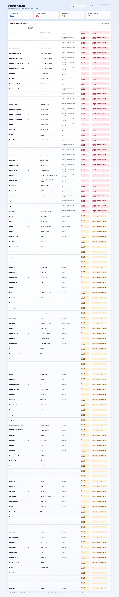

# Laravel Server Security Update Monitor

[](https://packagist.org/packages/laravel-server-security-update-monitor)
[](https://packagist.org/packages/laravel-server-security-update-monitor)
[](https://packagist.org/packages/laravel-server-security-update-monitor)
[](https://laravel.com)
[](https://github.com/mertaydin/laravel-server-security-update-monitor/actions/workflows/tests.yml)
[](LICENSE)


A Laravel dashboard for Linux server package updates and security patches. It automatically detects APT on Debian/Ubuntu and DNF/YUM on Fedora, RHEL-compatible and Amazon Linux distributions.


## Dashboard screenshot

The screenshot is automatically recaptured from the real package dashboard in a temporary Laravel application by GitHub Actions.

<p align="center">
  
</p>

> Preview uses illustrative package data; the live dashboard displays values collected from your server.

## Dashboard

The dashboard provides an at-a-glance view of pending updates and a package table with installed version, candidate version, repository suite, update classification and severity status.

- Total pending package updates.
- Security-repository updates, separated from routine updates.
- Installed and candidate package versions.
- Security updates sorted before routine updates.
- A manual scan action and cached scan results.
- Six dashboard languages: Turkish, English, Arabic, Spanish, Hindi and Simplified Chinese.
- Light, dark and system appearance modes with browser-persisted preference.
- An Artisan command for scheduled or manual scans.

## Requirements

- PHP 8.2+
- Laravel 10, 11, 12 or 13
- Debian/Ubuntu with APT and dpkg-query, or Fedora/RHEL-compatible/Amazon Linux with DNF/YUM and RPM.
- The PHP process must be allowed to execute package inspection commands. APT scans are read-only and use the currently available local package indexes. Refreshing APT indexes is a separate dashboard action; when PHP runs as a non-root user, grant narrowly scoped passwordless sudo permission for `/usr/bin/apt-get update` only.


> [!CAUTION]
> **Optional APT index refresh permission — security risk accepted by the server administrator**
>
> When the dashboard's **Update package lists** action reports `sudo: a password is required` or cannot execute `apt-get update`, the PHP-FPM process may not have permission to run this command. If you intentionally want to enable this feature, first identify the actual PHP-FPM user on your server. Then, as root, create a dedicated sudoers file with `sudo visudo -f /etc/sudoers.d/server-security-update-monitor` and add only the following rule (replace `www-data` if your PHP-FPM user is different):
>
> ```sudoers
> www-data ALL=(root) NOPASSWD: /usr/bin/apt-get update
> ```
>
> Validate the file with `sudo visudo -cf /etc/sudoers.d/server-security-update-monitor` and ensure it has mode `0440` (`sudo chmod 0440 /etc/sudoers.d/server-security-update-monitor`). Test the permission using `sudo -u www-data sudo -n /usr/bin/apt-get update`, replacing the user name as needed.
>
> **You must understand and explicitly accept this risk before applying the rule.** Although the rule is restricted to the APT index refresh command and does not grant general passwordless sudo or permission to install/upgrade/remove packages, it still allows the web application's PHP-FPM user to execute that command as root. A compromised application or an abused dashboard account could trigger repeated refreshes, causing network, disk and CPU usage. Also review your APT configuration: locally configured APT hooks may run during an update with elevated privileges. Protect the dashboard with strict administrator authorization, keep the application and server patched, and do not use broad rules such as `NOPASSWD: ALL` or wildcard command arguments. If you do not accept these risks, **do not add the sudoers rule**; the dashboard can continue scanning using the package indexes already present on the server, but the manual refresh action will not work.

## Installation

```bash
composer require mertaydin/laravel-server-security-update-monitor
php artisan vendor:publish --tag=server-security-update-monitor-config
php artisan vendor:publish --tag=server-security-update-monitor-assets
```

Open `/server-security-monitor` while authenticated. The default route middleware is `web` and `auth`; add an application-specific administrator check or network restriction before exposing operational details.

## Language and appearance

The dashboard supports Turkish, English, Arabic, Spanish, Hindi and Simplified Chinese. Language selection is stored in the current session. Appearance supports light, dark and system themes and is saved in the current browser.

## Access control

The dashboard uses `web` and `auth` middleware by default. Add an application-specific authorization callback in `app/Providers/AppServiceProvider.php`:

```php
use Illuminate\\Http\\Request;
use MertAydin\\ServerSecurityUpdateMonitor\\Facades\\ServerSecurityUpdateMonitor;

public function boot(): void
{
    ServerSecurityUpdateMonitor::auth(function (Request $request) {
        return $request->user()
            && $request->user()->hasRole('SuperAdmin');
    });
}
```

Return `true` to allow access and `false` to respond with HTTP 403. The callback receives the current request. If omitted, access is denied with HTTP 403; the configured `web` and `auth` middleware remain in effect.

## Scan

Run a scan manually:

```bash
php artisan server-security-monitor:check
```

The **Check now** action scans using the package indexes already present on the server and does not run `apt-get update`. On APT systems, use the separate **Update package lists** dashboard button when you want to refresh repository metadata. The refresh completes independently; select **Check now** afterward to scan using the new metadata.

## Security classification and severity

APT packages are marked as security updates only when their repository suite matches the configured security suite patterns (by default, `-security` or `/security`). DNF/YUM packages are marked as security updates only when they appear in the package manager's available security-advisory list (`updateinfo list --available --security`). If advisory metadata cannot be read, packages are not guessed to be security updates. A newer package version alone is not treated as evidence of a vulnerability.

**Severity is intentionally shown as unknown in this initial release.** APT's upgrade list does not provide reliable CVSS scores or vendor advisory severity. The package will not label every security-pocket update as Critical or High without matching an authoritative advisory to the package and fixed version. CVE/USN/DSA enrichment is planned.

## Package manager support

| Package manager | Status |
| --- | --- |
| APT (Debian/Ubuntu) | Initial support |
| DNF/YUM | Supported |
| APK | Planned |

## Configuration

The published `config/server-security-update-monitor.php` file controls:

| Key | Default | Description |
| --- | --- | --- |
| `route.enabled` | `true` | Registers the dashboard route. |
| `route.prefix` | `server-security-monitor` | Dashboard URL prefix. |
| `route.middleware` | `web, auth` | Middleware protecting the dashboard. |
| `cache.key` | `server-security-update-monitor.packages` | Cached scan key. |
| `cache.seconds` | `900` | Cached snapshot lifetime. |
| `command_timeout` | `30` | APT command timeout in seconds. |
| `apt.enabled` | `true` | Enables APT scanning. |
| `apt.update_timeout` | `300` | Maximum time in seconds allowed for the manual dashboard `apt-get update` action. |
| `apt.security_suites` | `-security, /security` | Suite patterns considered security repositories. |
| `dnf.enabled` | `true` | Enables automatic DNF/YUM detection. |
| `dnf.binaries` | `/usr/bin/dnf`, `/usr/bin/yum`, `/bin/dnf`, `/bin/yum` | DNF/YUM executable candidates. |
| `apk.enabled` | `true` | Reserved for the planned Alpine APK scanner. |

## Safety

- Read-only package inspection only.
- APT metadata refresh runs only when the separate dashboard action is explicitly selected. Scans never run `apt-get update`. The refresh action runs only `apt-get update`; it never runs `apt upgrade`, `apt install`, `dnf upgrade`, `yum update`, `apk upgrade`, or any package installation/removal command.
- Does not install, remove, or upgrade packages.
- Does not infer CVSS severity from repository names or version numbers.

## License

MIT. See [LICENSE](LICENSE).

## Support

- [Changelog](CHANGELOG.md)
- [GitHub releases](https://github.com/mertaydin/laravel-server-security-update-monitor/releases)
- [Issues](https://github.com/mertaydin/laravel-server-security-update-monitor/issues)

---

**Dil / Language:** [Türkçe README](README.tr.md) · [English README](README.md)
