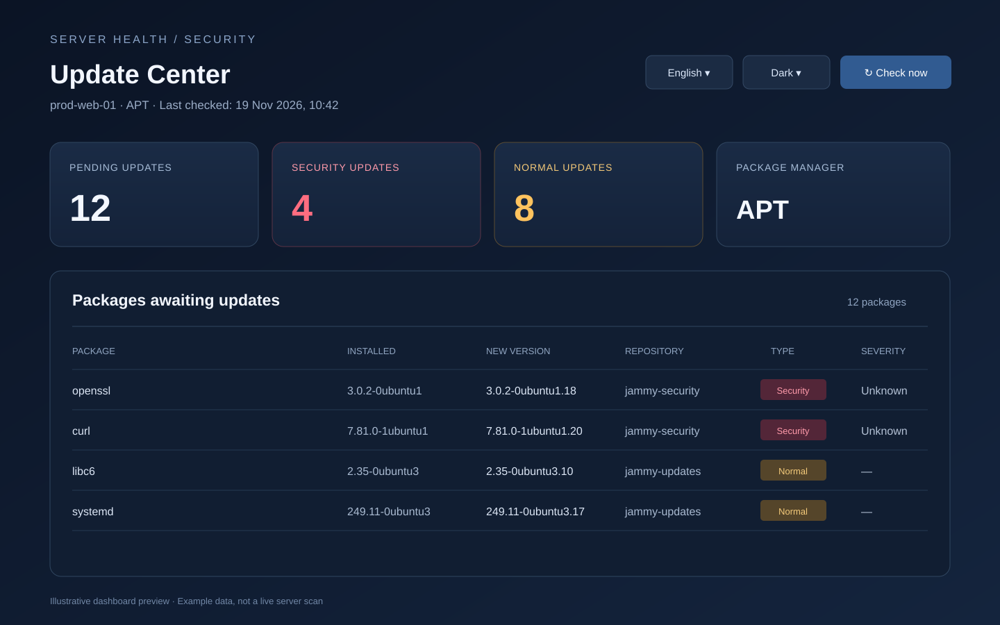

# Laravel Server Security Update Monitor

A Laravel dashboard for Linux server package updates and security patches. It automatically detects APT on Debian/Ubuntu and DNF/YUM on Fedora, RHEL-compatible and Amazon Linux distributions.

[](https://github.com/mertaydin/laravel-server-security-update-monitor/actions/workflows/tests.yml)
[](LICENSE)

## Dashboard screenshot

<p align="center">
  
</p>

> Preview uses illustrative package data; the live dashboard displays values collected from your server.

## Dashboard

The dashboard provides an at-a-glance view of pending updates and a package table with installed version, candidate version, repository suite, update classification and severity status.

- Total pending package updates.
- Security-repository updates, separated from routine updates.
- Installed and candidate package versions.
- Security updates sorted before routine updates.
- A manual scan action and cached scan results.
- Six dashboard languages: Turkish, English, Arabic, Spanish, Hindi and Simplified Chinese.
- Light, dark and system appearance modes with browser-persisted preference.
- An Artisan command for scheduled or manual scans.

## Requirements

- PHP 8.2+
- Laravel 10, 11, 12 or 13
- Debian/Ubuntu with APT and dpkg-query, or Fedora/RHEL-compatible/Amazon Linux with DNF/YUM and RPM.
- The PHP process must be allowed to execute package inspection commands. By default, APT scans also run `apt-get update`; when PHP runs as a non-root user, grant narrowly scoped passwordless sudo permission for `/usr/bin/apt-get update` only.

## Installation

```bash
composer require mertaydin/laravel-server-security-update-monitor
php artisan vendor:publish --tag=server-security-update-monitor-config
php artisan vendor:publish --tag=server-security-update-monitor-assets
```

Open `/server-security-monitor` while authenticated. The default route middleware is `web` and `auth`; add an application-specific administrator check or network restriction before exposing operational details.

## Language and appearance

The dashboard supports Turkish, English, Arabic, Spanish, Hindi and Simplified Chinese. Language selection is stored in the current session. Appearance supports light, dark and system themes and is saved in the current browser.

## Access control

The dashboard uses `web` and `auth` middleware by default. Add an application-specific authorization callback in `app/Providers/AppServiceProvider.php`:

```php
use Illuminate\\Http\\Request;
use MertAydin\\ServerSecurityUpdateMonitor\\Facades\\ServerSecurityUpdateMonitor;

public function boot(): void
{
    ServerSecurityUpdateMonitor::auth(function (Request $request) {
        return $request->user()
            && $request->user()->hasRole('SuperAdmin');
    });
}
```

Return `true` to allow access and `false` to respond with HTTP 403. The callback receives the current request; if omitted, the configured `web` and `auth` middleware remain in effect.

## Scan

Run a scan manually:

```bash
php artisan server-security-monitor:check
```

The dashboard also scans when no cached snapshot exists. Use your normal server maintenance process to refresh APT package indexes (for example, `apt-get update`). This package does not refresh package indexes automatically.

## Security classification and severity

APT packages are marked as security updates only when their repository suite matches the configured security suite patterns (by default, `-security` or `/security`). DNF/YUM packages are marked as security updates only when they appear in the package manager's available security-advisory list (`updateinfo list --available --security`). If advisory metadata cannot be read, packages are not guessed to be security updates. A newer package version alone is not treated as evidence of a vulnerability.

**Severity is intentionally shown as unknown in this initial release.** APT's upgrade list does not provide reliable CVSS scores or vendor advisory severity. The package will not label every security-pocket update as Critical or High without matching an authoritative advisory to the package and fixed version. CVE/USN/DSA enrichment is planned.

## Package manager support

| Package manager | Status |
| --- | --- |
| APT (Debian/Ubuntu) | Initial support |
| DNF/YUM | Planned |
| APK | Planned |

## Configuration

The published `config/server-security-update-monitor.php` file controls:

| Key | Default | Description |
| --- | --- | --- |
| `route.enabled` | `true` | Registers the dashboard route. |
| `route.prefix` | `server-security-monitor` | Dashboard URL prefix. |
| `route.middleware` | `web, auth` | Middleware protecting the dashboard. |
| `cache.key` | `server-security-update-monitor.packages` | Cached scan key. |
| `cache.seconds` | `900` | Cached snapshot lifetime. |
| `command_timeout` | `30` | APT command timeout in seconds. |
| `apt.enabled` | `true` | Enables APT scanning. |
| `apt.update_package_lists` | `true` | Runs exactly `apt-get update` before each uncached APT scan. Set to `false` to use existing local package indexes. |
| `apt.update_timeout` | `300` | Maximum time in seconds allowed for `apt-get update`. |
| `apt.security_suites` | `-security, /security` | Suite patterns considered security repositories. |
| `dnf.enabled` | `true` | Enables automatic DNF/YUM detection. |
| `dnf.binaries` | `/usr/bin/dnf`, `/usr/bin/yum`, `/bin/dnf`, `/bin/yum` | DNF/YUM executable candidates. |
| `apk.enabled` | `true` | Reserved for the planned Alpine APK scanner. |

## Safety

- Read-only package inspection only.
- On APT systems, runs only `apt-get update` before an uncached scan (configurable). It never runs `apt upgrade`, `apt install`, `dnf upgrade`, `yum update`, `apk upgrade`, or any package installation/removal command.
- Does not install, remove, or upgrade packages.
- Does not infer CVSS severity from repository names or version numbers.

## License

MIT. See [LICENSE](LICENSE).

## Support

- [Changelog](CHANGELOG.md)
- [GitHub releases](https://github.com/mertaydin/laravel-server-security-update-monitor/releases)
- [Issues](https://github.com/mertaydin/laravel-server-security-update-monitor/issues)
