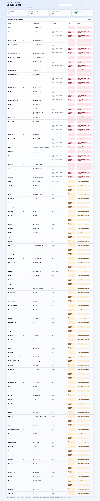

# Laravel Server Security Update Monitor

[](https://packagist.org/packages/laravel-server-security-update-monitor)
[](https://packagist.org/packages/laravel-server-security-update-monitor)
[](https://packagist.org/packages/laravel-server-security-update-monitor)
[](https://laravel.com)
[](https://github.com/mertaydin/laravel-server-security-update-monitor/actions/workflows/tests.yml)
[](LICENSE)


Linux sunucularındaki paket güncellemelerini ve güvenlik yamalarını izlemek için Laravel paneli. Debian/Ubuntu üzerinde APT, Fedora, RHEL uyumlu dağıtımlar ve Amazon Linux üzerinde DNF/YUM paket yöneticisini otomatik algılar.


## Panel ekran görüntüsü

Ekran görüntüsü GitHub Actions tarafından geçici bir Laravel uygulamasında paketin gerçek panelinden otomatik olarak yeniden alınır.

<p align="center">
  
</p>

> Önizlemede örnek paket verileri kullanılır; canlı panel sunucunuzdan toplanan değerleri gösterir.

## Panel

Panel, bekleyen güncellemeleri; kurulu/aday sürümleri, depo bilgisi, güncelleme sınıflandırması, üretici duyuru kimlikleri, CVE referansları ve kaynağın sağladığı önem derecesiyle birlikte gösterir. Paketler aranabilir ve güncelleme türü/önem derecesine göre filtrelenebilir.

- Toplam bekleyen paket güncellemesi.
- Rutin güncellemelerden ayrı gösterilen güvenlik deposu güncellemeleri.
- Kurulu ve aday paket sürümleri.
- Güvenlik güncellemelerinin rutin güncellemelerden önce sıralanması.
- Manuel tarama işlemi ve önbelleğe alınmış tarama sonuçları.
- Türkçe, İngilizce, Arapça, İspanyolca, Hintçe ve Basitleştirilmiş Çince olmak üzere altı panel dili.
- Tarayıcıda saklanan tercihle açık, koyu ve sistem görünüm modları.
- Zamanlanmış veya manuel taramalar için Artisan komutu.

## Gereksinimler

- PHP 8.2+
- Laravel 10, 11, 12 veya 13
- APT ve dpkg-query bulunan Debian/Ubuntu veya DNF/YUM ve RPM bulunan Fedora/RHEL uyumlu/Amazon Linux.
- PHP süreci paket inceleme komutlarını çalıştırabilmelidir. APT taramaları salt okunurdur ve sunucudaki mevcut yerel paket indekslerini kullanır. APT indekslerini yenilemek ayrı bir panel işlemidir; PHP root olmayan kullanıcıyla çalışıyorsa yalnızca `/usr/bin/apt-get update` için dar kapsamlı parolasız sudo izni verin.


> [!CAUTION]
> **İsteğe bağlı APT paket listesi yenileme izni — sunucu yöneticisinin kabul etmesi gereken güvenlik riski**
>
> Paneldeki **Paket Listelerini Güncelle** işlemi `sudo: a password is required` hatası verirse veya `apt-get update` komutunu çalıştıramazsa PHP-FPM sürecinin bu komutu çalıştırma izni olmayabilir. Bu özelliği etkinleştirmek istiyorsanız önce sunucudaki gerçek PHP-FPM kullanıcısını belirleyin. Ardından root olarak `sudo visudo -f /etc/sudoers.d/server-security-update-monitor` komutuyla özel bir sudoers dosyası oluşturun ve yalnızca aşağıdaki kuralı ekleyin (PHP-FPM kullanıcınız farklıysa `www-data` yerine onu yazın):
>
> ```sudoers
> www-data ALL=(root) NOPASSWD: /usr/bin/apt-get update
> ```
>
> Dosyayı `sudo visudo -cf /etc/sudoers.d/server-security-update-monitor` komutuyla doğrulayın ve izinlerinin `0440` olduğundan emin olun (`sudo chmod 0440 /etc/sudoers.d/server-security-update-monitor`). Yetkiyi `sudo -u www-data sudo -n /usr/bin/apt-get update` komutuyla test edin; gerekiyorsa kullanıcı adını değiştirin.
>
> **Bu kuralı uygulamadan önce riski anlamalı ve açıkça kabul etmelisiniz.** Kural yalnızca APT paket listesi yenileme komutuyla sınırlandırılmıştır; genel parolasız sudo veya paket kurma/yükseltme/kaldırma yetkisi vermez. Bununla birlikte web uygulamasının PHP-FPM kullanıcısına bu komutu root olarak çalıştırma imkânı tanır. Ele geçirilmiş bir uygulama veya kötüye kullanılan bir panel hesabı, yenileme işlemini tekrar tekrar başlatarak ağ, disk ve işlemci kaynaklarını tüketebilir. Ayrıca APT yapılandırmanızı kontrol edin: sistemde tanımlı yerel APT hook'ları güncelleme sırasında yükseltilmiş yetkilerle çalışabilir. Paneli sıkı yönetici yetkilendirmesiyle koruyun, uygulamayı ve sunucuyu güncel tutun; `NOPASSWD: ALL` veya joker karakterli geniş komut kuralları kullanmayın. Bu riskleri kabul etmiyorsanız **sudoers kuralını eklemeyin**; panel mevcut paket indeksleriyle tarama yapmaya devam edebilir ancak manuel liste yenileme işlemi çalışmaz.

## Kurulum

```bash
composer require mertaydin/laravel-server-security-update-monitor
php artisan vendor:publish --tag=server-security-update-monitor-config
php artisan vendor:publish --tag=server-security-update-monitor-assets
```

Kimliği doğrulanmış olarak `/server-security-monitor` adresini açın. Varsayılan rota middleware'i `web` ve `auth` şeklindedir. Operasyonel ayrıntıları açmadan önce uygulamaya özel yönetici kontrolü veya ağ kısıtlaması ekleyin.

## Dil ve görünüm

Panel Türkçe, İngilizce, Arapça, İspanyolca, Hintçe ve Basitleştirilmiş Çince dillerini destekler. Dil seçimi mevcut oturumda saklanır. Görünüm açık, koyu ve sistem temalarını destekler; tercih mevcut tarayıcıda saklanır.

## Erişim kontrolü

Panel varsayılan olarak `web` ve `auth` middleware'lerini kullanır. `app/Providers/AppServiceProvider.php` içinde uygulamaya özel yetkilendirme callback'i ekleyin:

```php
use Illuminate\Http\Request;
use MertAydin\ServerSecurityUpdateMonitor\Facades\ServerSecurityUpdateMonitor;

public function boot(): void
{
    ServerSecurityUpdateMonitor::auth(function (Request $request) {
        return $request->user()
            && $request->user()->hasRole('SuperAdmin');
    });
}
```

Erişime izin vermek için `true`, HTTP 403 yanıtı için `false` döndürün. Callback mevcut isteği alır. Callback yoksa erişim HTTP 403 ile reddedilir; yapılandırılmış `web` ve `auth` middleware'leri de geçerlidir.

## Tarama

Manuel tarama başlatın:

```bash
php artisan server-security-monitor:check
```

**Şimdi Kontrol Et** işlemi sunucuda zaten bulunan paket indekslerini kullanır ve `apt-get update` çalıştırmaz. APT sistemlerinde depo metadata bilgilerini yenilemek istediğinizde ayrı **Paket Listelerini Güncelle** panel düğmesini kullanın. Yenileme bağımsız olarak tamamlanır; ardından yeni metadata ile tarama yapmak için **Şimdi Kontrol Et** seçeneğini kullanın.

## Güvenlik sınıflandırması ve önem derecesi

APT paketleri yalnızca depo suite bilgisi yapılandırılmış güvenlik suite kalıplarıyla (varsayılan olarak `-security` veya `/security`) eşleştiğinde güvenlik güncellemesi olarak işaretlenir. DNF/YUM paketleri yalnızca kullanılabilir üretici güvenlik duyurularıyla eşleşiyorsa güvenlik güncellemesi sayılır. DNF5, CVE referanslarını içeren JSON duyuru arayüzünü; DNF4/YUM ise `updateinfo info --available --security` çıktısını kullanır. Duyuru metadata bilgisi okunamazsa paketlerin güvenlik güncellemesi olduğu tahmin edilmez. Daha yeni bir paket sürümü tek başına güvenlik açığı kanıtı değildir.

APT güvenlik metadata bilgileri mümkün olduğunda OSV kayıtlarıyla zenginleştirilir. Önce kurulu kaynak paket sürümü sorgulanır; güvenlik açığı yalnızca OSV kaydındaki paket/ekosistem eşleştiğinde ve aday sürüm yayımlanmış düzeltilmiş sürüme ulaştığında ilişkilendirilir. Mevcutsa CVE takma adları, duyuru bağlantıları ve kaynağın sağladığı önem derecesi gösterilir. OSV erişim hataları taramayı durdurmaz; bilinmeyen önem derecesi tahmin edilmez.

## Paket yöneticisi desteği

| Paket yöneticisi | Durum |
| --- | --- |
| APT (Debian/Ubuntu) | İlk destek |
| DNF5 | Destekleniyor (JSON güncelleme ve duyuru metadata bilgisi) |\n| DNF4/YUM | Destekleniyor (metin tabanlı updateinfo metadata bilgisi) |
| APK | Planlandı |

## Yapılandırma

Yayımlanan `config/server-security-update-monitor.php` dosyası şu seçenekleri kontrol eder:

| Anahtar | Varsayılan | Açıklama |
| --- | --- | --- |
| `route.enabled` | `true` | Panel rotasını kaydeder. |
| `route.prefix` | `server-security-monitor` | Panel URL öneki. |
| `route.middleware` | `web, auth` | Paneli koruyan middleware. |
| `cache.key` | `server-security-update-monitor.packages` | Önbelleğe alınan tarama anahtarı. |
| `cache.seconds` | `900` | Anlık görüntünün önbellekte kalma süresi. |
| `command_timeout` | `30` | APT komutu zaman aşımı (saniye). |
| `apt.enabled` | `true` | APT taramasını etkinleştirir. |
| `apt.update_timeout` | `300` | Paneldeki manuel `apt-get update` işlemi için izin verilen en uzun süre (saniye). |
| `apt.security_suites` | `-security, /security` | Güvenlik deposu kabul edilen suite kalıpları. |\n| `apt.osv.enabled` | `true` | Ubuntu/Debian OSV duyuru zenginleştirmesini etkinleştirir. |\n| `apt.osv.timeout` | `5` | OSV HTTP isteği zaman aşımı (saniye). |
| `dnf.enabled` | `true` | DNF/YUM otomatik algılamasını etkinleştirir. |
| `dnf.binaries` | `/usr/bin/dnf`, `/usr/bin/dnf5`, `/usr/bin/yum`, `/bin/dnf`, `/bin/dnf5`, `/bin/yum` | DNF/YUM çalıştırılabilir dosya adayları. |
| `apk.enabled` | `true` | Planlanan Alpine APK tarayıcısı için ayrılmıştır. |

## Güvenlik

- Yalnızca salt okunur paket incelemesi yapılır.
- APT metadata yenilemesi yalnızca ayrı panel işlemi açıkça seçildiğinde çalışır. Tarama hiçbir zaman `apt-get update` çalıştırmaz. Yenileme işlemi yalnızca `apt-get update` komutunu çalıştırır; `apt upgrade`, `apt install`, `dnf upgrade`, `yum update`, `apk upgrade` veya herhangi bir paket kurma/kaldırma komutunu çalıştırmaz.
- Paket kurmaz, kaldırmaz veya yükseltmez.
- Depo adlarından veya sürüm numaralarından CVSS önem derecesi çıkarımı yapmaz.

## Lisans

[LICENSE](LICENSE) dosyasına bakın. MIT.

## Destek

- [Değişiklik günlüğü](CHANGELOG.md)
- [GitHub sürümleri](https://github.com/mertaydin/laravel-server-security-update-monitor/releases)
- [Sorunlar](https://github.com/mertaydin/laravel-server-security-update-monitor/issues)
